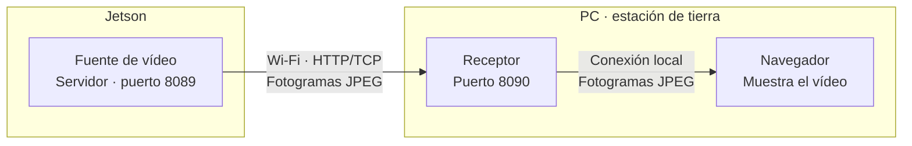

# Conexión de vídeo entre la Jetson y el PC

He preparado este repo para probar la conexión de vídeo sin tener el dron delante. Un programa hace de servidor y el otro pide las imágenes y las muestra. Puedes ejecutar ambos en tu ordenador y después pasar el servidor a una Jetson de la ULL.

Con `--demo` las imágenes son simuladas, pero **el intercambio HTTP/TCP es real**. La demo usa CPU; no necesita CUDA ni un modelo de visión.



Las flechas muestran el recorrido de las imágenes. El navegador las solicita al receptor y este a la fuente. En la prueba local, la fuente también se ejecuta en el PC.

## Probarlo

Python 3.10 o superior. Solo la fuente necesita OpenCV:

```bash
python -m pip install -r video/requirements.txt
```

Servidor:

```bash
python video/fuente_jpeg.py --demo
```

Receptor, en otra terminal:

```bash
python video/recibir_video.py --url http://127.0.0.1:8089
```

Abre **http://127.0.0.1:8090**. En Linux puedes usar `python3`.

## Pasarlo a la Jetson

Conecta la Jetson y el PC a la misma Wi-Fi. En la Jetson, con OpenCV instalado:

```bash
python3 video/fuente_jpeg.py --demo --host 0.0.0.0 --port 8089
```

En el PC, sustituye `IP_DE_LA_JETSON` por su dirección en esa red; puedes consultarla con `hostname -I` en la Jetson:

```bash
python video/recibir_video.py --url http://IP_DE_LA_JETSON:8089
```

El visor sigue en **http://127.0.0.1:8090**, en el PC. Si no conecta, comprueba `http://IP_DE_LA_JETSON:8089/status`, la IP y el acceso al puerto TCP 8089 desde tu red local.

## Usar un vídeo o una cámara

Para el servidor anterior y cambia `--demo` por un archivo:

```bash
python video/fuente_jpeg.py --rgb "video.mp4" --loop --host 0.0.0.0 --port 8089
```

También admite `--rgb rtsp://IP_CAMARA/RUTA` si la cámara entrega vídeo y OpenCV puede leerlo. El receptor no cambia.

| Ruta de la fuente | Contenido |
|---|---|
| `/rgb.jpg` | Último fotograma en JPEG. |
| `/thermal.jpg` | Segundo canal, si está disponible. En la demo es ficticio. |
| `/status` | Estado de la fuente en JSON. |

Para ver el segundo canal, añade `--channel thermal` al receptor. Un archivo RGB no crea ese canal.

## Comprobar la conexión

Sin abrir el visor:

```bash
python video/recibir_video.py --url http://IP_DE_LA_JETSON:8089 --check 30
```

En local usa `127.0.0.1`. Muestra peticiones correctas, fallos, fotogramas únicos y tiempo de petición HTTP; **no mide la latencia completa de cámara a pantalla**.

Pruebas automáticas:

```bash
python -m unittest discover -s video -p test_video.py -v
```

## Añadir la protección

El código envía JPEG **sin cifrar** y el servidor no tiene autenticación: está pensado como referencia para pruebas en una red local. El cifrado todavía no está implementado.

Si proteges los bytes antes de enviarlos, recupera el JPEG original en el PC antes de entregarlo al visor. Usa la misma fuente y ajustes para comparar funcionamiento, tiempo y tamaño de los mensajes antes y después.

He dejado la fuente en **8089** para no ocupar el **8088** del servicio de vídeo del dron. El receptor también puede apuntar a ese servicio cuando esté entregando imágenes.
